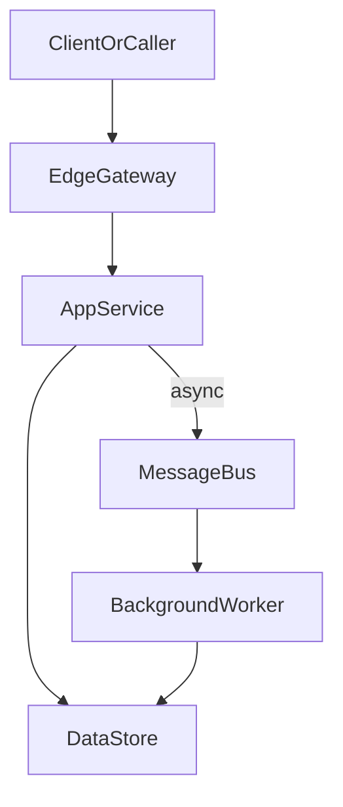

# D35-T018 — Multi-region replication

Topic ID: `D35-T018`
Domain: Advanced and Specialized Topics
Subdomain: Multi-region replication
Importance: advanced
Complexity: advanced
Dependencies: `D35-T017`, `D35-T001`, `D15-T001`, `D15-T002`, `D09-T001`, `D09-T002`
Execution status of the code in section F: not executed (documentation example)

## A. Topic Overview

Multi-region replication is a backend engineering concern because production systems must handle real traffic, failures, and evolving requirements—not only happy-path demos. In interviews, strong candidates explain how Multi-region replication affects latency, consistency, cost, and operability instead of naming a tool without context. This topic sits in domain 35 (Advanced and Specialized Topics) and connects to dependencies such as `D35-T017`.

## B. First-Principles Explanation

At the root, Multi-region replication answers a constraint: limited CPU, network partitions, untrusted input, or business rules that must hold under retries. First-principles thinking lists the actors, the data they exchange, and the invariant that must remain true after crashes or duplicate requests. Alternatives exist because no single pattern optimizes for simplicity, scale, and correctness at once; you choose based on measurable requirements. Internal details matter when they change failure modes—for example whether state is centralized, replicated, or cached—and who must reconcile conflicts.

For Multi-region replication, draw the write path and the read path separately; many bugs appear when they assume different sources of truth. State transitions should be explicit: what is persisted, what is ephemeral, and what happens if a worker dies mid-step. Boundaries (API, queue, database, external SaaS) are where typing, authorization, and idempotency belong.

## C. Internal Working and Architecture

Typical components for Multi-region replication: an edge entrypoint, application services, a primary datastore, optional cache or search index, and asynchronous workers. Control plane configuration (feature flags, quotas, routing rules) should be versioned separately from data plane request handling so rollbacks are fast. Under load, the bottleneck for Multi-region replication is often IO to the datastore or an external dependency; CPU profiling alone can mislead.

Observability hooks belong at each hop: trace id propagation, structured logs with tenant id, and RED/USE metrics per dependency. Security checks are not optional extras—they must run before expensive work and before side-effecting tools or transactions.

## D. Diagrams and Visual Models



This diagram highlights the main data flow for Multi-region replication. Node ids are alphanumeric only for Mermaid compatibility.

## E. Examples and Analogies

Analogy: treating Multi-region replication like a traffic intersection—rules only work if everyone sees the same lights; hidden shortcuts become incidents. Backend example: a checkout service applying Multi-region replication must still charge exactly once when the client retries POST after a timeout. Do not skip explicit limits at the edge; unbounded queues turn latency problems into data loss problems.

## F. Code Examples

File: `examples/d35_t018.py`

Dependencies: Python 3 standard library unless noted.

```python
"""Sketch related to Multi-region replication (illustrative)."""
from typing import Any, Dict

def handle_request(ctx: Dict[str, Any]) -> Dict[str, Any]:
    """Validate, authorize, then execute domain logic."""
    if "tenant_id" not in ctx:
        raise ValueError("tenant_id required")
    # Domain-specific logic for Multi-region replication belongs here.
    return {"status": "ok", "topic": "D35-T018"}

if __name__ == "__main__":
    print(handle_request({"tenant_id": "t1"}))
```

How to run: `python examples/d35_t018.py` from `EXERCISES/examples/` after copying the snippet.

Expected output: `{"status": "ok", "topic": "D35-T018"}`

The snippet is illustrative; wire real persistence and auth before production.
Keep side effects behind interfaces so tests can use fakes.

## G. Practical Backend Application

Roll out Multi-region replication behind a feature flag when behavior changes are risky; measure p95 latency and error rate per tenant during canary. Document SLO impact: which user journeys degrade if this component fails and what fallback UX is acceptable. Run game days or table-top exercises for the highest-risk dependencies before peak traffic seasons.

## H. Advantages, Limitations and Trade-offs

| Choice | Benefit | Cost | Choose when | Avoid when |
| --- | --- | --- | --- | --- |
| Minimal Multi-region replication | Fast to ship, easy to reason about | Breaks under scale or abuse | Early product, low risk | Regulated or multi-tenant production |
| Managed Multi-region replication | Ops burden shifts to vendor | Cost, less control | Small team, standard needs | Hard latency or compliance constraints |
| Custom Multi-region replication | Fits exact policy | Build and test cost | Differentiating requirement | Commodity problem with mature libs |
| No Multi-region replication | Fewer moving parts | Pain appears suddenly at scale | Prototypes | Known hot path or compliance gap |

Under abuse or viral traffic, Multi-region replication must fail closed or shed load rather than retry infinitely into dependencies.

## I. Common Mistakes and Misconceptions

- Treating Multi-region replication as purely infrastructure with no product-visible failure modes.
- Omitting idempotency when clients or brokers retry.
- Sharing mutable state across requests without clear ownership.

## J. Debugging and Troubleshooting

Symptoms involving Multi-region replication often show up as elevated p95 latency, rising error budgets, or skewed saturation on one dependency. Separate client-side retries from server overload by checking retry headers and comparing 5xx rates with upstream latency. Capture exemplar traces for slow requests and verify whether the database, cache, or external API dominates span time. After mitigation, add a regression test or alert on the earliest signal that preceded the incident.

## K. Interview Preparation

### Beginner

#### Q1. What problem does Multi-region replication solve in a backend system?

**Answer:** Question: What problem does Multi-region replication solve in a backend system? — in the context of Multi-region replication, interviewers at the beginner level want foundations and vocabulary tied to this exact point. Start with the user-visible behavior or SLA, then walk inward through the request path until you name the component that enforces the rule or holds the state. For item 1 in this tier, add one concrete production detail: a metric name, a timeout value order-of-magnitude, or a consistency choice (strong vs eventual) with a product reason. Close by stating a failure mode and mitigation so the answer sounds like on-call experience, not a glossary entry.

#### Q2. What are the main components involved in Multi-region replication?

**Answer:** Question: What are the main components involved in Multi-region replication? — in the context of Multi-region replication, interviewers at the beginner level want foundations and vocabulary tied to this exact point. Start with the user-visible behavior or SLA, then walk inward through the request path until you name the component that enforces the rule or holds the state. For item 2 in this tier, add one concrete production detail: a metric name, a timeout value order-of-magnitude, or a consistency choice (strong vs eventual) with a product reason. Close by stating a failure mode and mitigation so the answer sounds like on-call experience, not a glossary entry.

#### Q3. How does Multi-region replication show up at an API boundary?

**Answer:** Question: How does Multi-region replication show up at an API boundary? — in the context of Multi-region replication, interviewers at the beginner level want foundations and vocabulary tied to this exact point. Start with the user-visible behavior or SLA, then walk inward through the request path until you name the component that enforces the rule or holds the state. For item 3 in this tier, add one concrete production detail: a metric name, a timeout value order-of-magnitude, or a consistency choice (strong vs eventual) with a product reason. Close by stating a failure mode and mitigation so the answer sounds like on-call experience, not a glossary entry.

#### Q4. What is a common misconception about Multi-region replication?

**Answer:** Question: What is a common misconception about Multi-region replication? — in the context of Multi-region replication, interviewers at the beginner level want foundations and vocabulary tied to this exact point. Start with the user-visible behavior or SLA, then walk inward through the request path until you name the component that enforces the rule or holds the state. For item 4 in this tier, add one concrete production detail: a metric name, a timeout value order-of-magnitude, or a consistency choice (strong vs eventual) with a product reason. Close by stating a failure mode and mitigation so the answer sounds like on-call experience, not a glossary entry.

#### Q5. Which metric would you watch first after enabling Multi-region replication?

**Answer:** Question: Which metric would you watch first after enabling Multi-region replication? — in the context of Multi-region replication, interviewers at the beginner level want foundations and vocabulary tied to this exact point. Start with the user-visible behavior or SLA, then walk inward through the request path until you name the component that enforces the rule or holds the state. For item 5 in this tier, add one concrete production detail: a metric name, a timeout value order-of-magnitude, or a consistency choice (strong vs eventual) with a product reason. Close by stating a failure mode and mitigation so the answer sounds like on-call experience, not a glossary entry.

### Intermediate

#### Q1. Walk through the request path for Multi-region replication under normal load.

**Answer:** Question: Walk through the request path for Multi-region replication under normal load. — in the context of Multi-region replication, interviewers at the intermediate level want request paths and operational limits tied to this exact point. Start with the user-visible behavior or SLA, then walk inward through the request path until you name the component that enforces the rule or holds the state. For item 1 in this tier, add one concrete production detail: a metric name, a timeout value order-of-magnitude, or a consistency choice (strong vs eventual) with a product reason. Close by stating a failure mode and mitigation so the answer sounds like on-call experience, not a glossary entry.

#### Q2. How would you test Multi-region replication before a production rollout?

**Answer:** Question: How would you test Multi-region replication before a production rollout? — in the context of Multi-region replication, interviewers at the intermediate level want request paths and operational limits tied to this exact point. Start with the user-visible behavior or SLA, then walk inward through the request path until you name the component that enforces the rule or holds the state. For item 2 in this tier, add one concrete production detail: a metric name, a timeout value order-of-magnitude, or a consistency choice (strong vs eventual) with a product reason. Close by stating a failure mode and mitigation so the answer sounds like on-call experience, not a glossary entry.

#### Q3. What consistency or durability guarantees matter for Multi-region replication?

**Answer:** Question: What consistency or durability guarantees matter for Multi-region replication? — in the context of Multi-region replication, interviewers at the intermediate level want request paths and operational limits tied to this exact point. Start with the user-visible behavior or SLA, then walk inward through the request path until you name the component that enforces the rule or holds the state. For item 3 in this tier, add one concrete production detail: a metric name, a timeout value order-of-magnitude, or a consistency choice (strong vs eventual) with a product reason. Close by stating a failure mode and mitigation so the answer sounds like on-call experience, not a glossary entry.

#### Q4. How does Multi-region replication interact with retries and timeouts?

**Answer:** Question: How does Multi-region replication interact with retries and timeouts? — in the context of Multi-region replication, interviewers at the intermediate level want request paths and operational limits tied to this exact point. Start with the user-visible behavior or SLA, then walk inward through the request path until you name the component that enforces the rule or holds the state. For item 4 in this tier, add one concrete production detail: a metric name, a timeout value order-of-magnitude, or a consistency choice (strong vs eventual) with a product reason. Close by stating a failure mode and mitigation so the answer sounds like on-call experience, not a glossary entry.

#### Q5. Where would you place authorization checks relative to Multi-region replication?

**Answer:** Question: Where would you place authorization checks relative to Multi-region replication? — in the context of Multi-region replication, interviewers at the intermediate level want request paths and operational limits tied to this exact point. Start with the user-visible behavior or SLA, then walk inward through the request path until you name the component that enforces the rule or holds the state. For item 5 in this tier, add one concrete production detail: a metric name, a timeout value order-of-magnitude, or a consistency choice (strong vs eventual) with a product reason. Close by stating a failure mode and mitigation so the answer sounds like on-call experience, not a glossary entry.

### Advanced

#### Q1. What failure modes are unique to Multi-region replication at scale?

**Answer:** Question: What failure modes are unique to Multi-region replication at scale? — in the context of Multi-region replication, interviewers at the advanced level want edge cases and distributed failure tied to this exact point. Start with the user-visible behavior or SLA, then walk inward through the request path until you name the component that enforces the rule or holds the state. For item 1 in this tier, add one concrete production detail: a metric name, a timeout value order-of-magnitude, or a consistency choice (strong vs eventual) with a product reason. Close by stating a failure mode and mitigation so the answer sounds like on-call experience, not a glossary entry.

#### Q2. How would you design Multi-region replication for multi-region or multi-tenant isolation?

**Answer:** Question: How would you design Multi-region replication for multi-region or multi-tenant isolation? — in the context of Multi-region replication, interviewers at the advanced level want edge cases and distributed failure tied to this exact point. Start with the user-visible behavior or SLA, then walk inward through the request path until you name the component that enforces the rule or holds the state. For item 2 in this tier, add one concrete production detail: a metric name, a timeout value order-of-magnitude, or a consistency choice (strong vs eventual) with a product reason. Close by stating a failure mode and mitigation so the answer sounds like on-call experience, not a glossary entry.

#### Q3. Compare two implementation options for Multi-region replication and pick one with reasons.

**Answer:** Question: Compare two implementation options for Multi-region replication and pick one with reasons. — in the context of Multi-region replication, interviewers at the advanced level want edge cases and distributed failure tied to this exact point. Start with the user-visible behavior or SLA, then walk inward through the request path until you name the component that enforces the rule or holds the state. For item 3 in this tier, add one concrete production detail: a metric name, a timeout value order-of-magnitude, or a consistency choice (strong vs eventual) with a product reason. Close by stating a failure mode and mitigation so the answer sounds like on-call experience, not a glossary entry.

#### Q4. How do you prevent Multi-region replication from becoming a single point of failure?

**Answer:** Question: How do you prevent Multi-region replication from becoming a single point of failure? — in the context of Multi-region replication, interviewers at the advanced level want edge cases and distributed failure tied to this exact point. Start with the user-visible behavior or SLA, then walk inward through the request path until you name the component that enforces the rule or holds the state. For item 4 in this tier, add one concrete production detail: a metric name, a timeout value order-of-magnitude, or a consistency choice (strong vs eventual) with a product reason. Close by stating a failure mode and mitigation so the answer sounds like on-call experience, not a glossary entry.

#### Q5. What load or chaos tests would you run for Multi-region replication?

**Answer:** Question: What load or chaos tests would you run for Multi-region replication? — in the context of Multi-region replication, interviewers at the advanced level want edge cases and distributed failure tied to this exact point. Start with the user-visible behavior or SLA, then walk inward through the request path until you name the component that enforces the rule or holds the state. For item 5 in this tier, add one concrete production detail: a metric name, a timeout value order-of-magnitude, or a consistency choice (strong vs eventual) with a product reason. Close by stating a failure mode and mitigation so the answer sounds like on-call experience, not a glossary entry.

### Scenarios

#### Q1. Latency spikes right after a deploy touching Multi-region replication. What do you check first?

**Answer:** Question: Latency spikes right after a deploy touching Multi-region replication. What do you check first? — in the context of Multi-region replication, interviewers at the scenario level want on-call triage and mitigation order tied to this exact point. Start with the user-visible behavior or SLA, then walk inward through the request path until you name the component that enforces the rule or holds the state. For item 1 in this tier, add one concrete production detail: a metric name, a timeout value order-of-magnitude, or a consistency choice (strong vs eventual) with a product reason. Close by stating a failure mode and mitigation so the answer sounds like on-call experience, not a glossary entry.

#### Q2. One tenant reports errors while others are healthy. How does Multi-region replication factor in?

**Answer:** Question: One tenant reports errors while others are healthy. How does Multi-region replication factor in? — in the context of Multi-region replication, interviewers at the scenario level want on-call triage and mitigation order tied to this exact point. Start with the user-visible behavior or SLA, then walk inward through the request path until you name the component that enforces the rule or holds the state. For item 2 in this tier, add one concrete production detail: a metric name, a timeout value order-of-magnitude, or a consistency choice (strong vs eventual) with a product reason. Close by stating a failure mode and mitigation so the answer sounds like on-call experience, not a glossary entry.

#### Q3. Costs doubled after enabling Multi-region replication. How do you investigate?

**Answer:** Question: Costs doubled after enabling Multi-region replication. How do you investigate? — in the context of Multi-region replication, interviewers at the scenario level want on-call triage and mitigation order tied to this exact point. Start with the user-visible behavior or SLA, then walk inward through the request path until you name the component that enforces the rule or holds the state. For item 3 in this tier, add one concrete production detail: a metric name, a timeout value order-of-magnitude, or a consistency choice (strong vs eventual) with a product reason. Close by stating a failure mode and mitigation so the answer sounds like on-call experience, not a glossary entry.

#### Q4. A dependency used by Multi-region replication is slow but not down. What mitigations apply?

**Answer:** Question: A dependency used by Multi-region replication is slow but not down. What mitigations apply? — in the context of Multi-region replication, interviewers at the scenario level want on-call triage and mitigation order tied to this exact point. Start with the user-visible behavior or SLA, then walk inward through the request path until you name the component that enforces the rule or holds the state. For item 4 in this tier, add one concrete production detail: a metric name, a timeout value order-of-magnitude, or a consistency choice (strong vs eventual) with a product reason. Close by stating a failure mode and mitigation so the answer sounds like on-call experience, not a glossary entry.

#### Q5. An audit asks for evidence that Multi-region replication is enforced. What artifacts do you provide?

**Answer:** Question: An audit asks for evidence that Multi-region replication is enforced. What artifacts do you provide? — in the context of Multi-region replication, interviewers at the scenario level want on-call triage and mitigation order tied to this exact point. Start with the user-visible behavior or SLA, then walk inward through the request path until you name the component that enforces the rule or holds the state. For item 5 in this tier, add one concrete production detail: a metric name, a timeout value order-of-magnitude, or a consistency choice (strong vs eventual) with a product reason. Close by stating a failure mode and mitigation so the answer sounds like on-call experience, not a glossary entry.

### Follow-ups

#### Q1. How does Multi-region replication relate to observability and SLOs?

**Answer:** Question: How does Multi-region replication relate to observability and SLOs? — in the context of Multi-region replication, interviewers at the follow-up level want dependencies on neighboring curriculum topics tied to this exact point. Start with the user-visible behavior or SLA, then walk inward through the request path until you name the component that enforces the rule or holds the state. For item 1 in this tier, add one concrete production detail: a metric name, a timeout value order-of-magnitude, or a consistency choice (strong vs eventual) with a product reason. Close by stating a failure mode and mitigation so the answer sounds like on-call experience, not a glossary entry.

#### Q2. Which earlier database or networking topics does Multi-region replication assume?

**Answer:** Question: Which earlier database or networking topics does Multi-region replication assume? — in the context of Multi-region replication, interviewers at the follow-up level want dependencies on neighboring curriculum topics tied to this exact point. Start with the user-visible behavior or SLA, then walk inward through the request path until you name the component that enforces the rule or holds the state. For item 2 in this tier, add one concrete production detail: a metric name, a timeout value order-of-magnitude, or a consistency choice (strong vs eventual) with a product reason. Close by stating a failure mode and mitigation so the answer sounds like on-call experience, not a glossary entry.

#### Q3. What would you study next after mastering Multi-region replication?

**Answer:** Question: What would you study next after mastering Multi-region replication? — in the context of Multi-region replication, interviewers at the follow-up level want dependencies on neighboring curriculum topics tied to this exact point. Start with the user-visible behavior or SLA, then walk inward through the request path until you name the component that enforces the rule or holds the state. For item 3 in this tier, add one concrete production detail: a metric name, a timeout value order-of-magnitude, or a consistency choice (strong vs eventual) with a product reason. Close by stating a failure mode and mitigation so the answer sounds like on-call experience, not a glossary entry.

## L. Practical Exercises

Solutions are in `EXERCISES/solutions/D35-T018.md`. Try these before opening that file.

### Exercise 1 — implementation

Implement a minimal service module that enforces the core invariant for `Multi-region replication`: validate inputs, apply authorization, and return structured errors. Acceptance: unit tests cover happy path, missing tenant, and duplicate request id.

### Exercise 2 — debugging

Given logs where p95 latency doubled after a deploy touching `Multi-region replication`, list the top five checks in order and which metric proves each hypothesis.

### Exercise 3 — trade-off

Choose between a managed platform feature and a custom implementation for `Multi-region replication`. Write one page comparing cost, operability, and blast radius; pick one with explicit trade-offs.

## M. Revision Notes

- Multi-region replication: know the invariant, the failure modes, and the metrics.
- Draw write and read paths before proposing tools.
- Retries require idempotency; caches require invalidation strategy.

Flashcards:

- What is the core risk if Multi-region replication is misconfigured? Data loss, inconsistency, or unbounded cost.
- Symptom vs root cause? Symptom is what users see; root cause is the broken invariant.
## N. Related Topics

Understand this before: `D35-T017`

This topic supports: the next topic in domain 35

Often confused with: adjacent topics in domain 35 with similar names

Interviewers combine this with: `D22-T001` observability, `D12-T001` API design, `D15-T001` distributed systems fundamentals

## O. Completion Criteria

- Explain Multi-region replication with a diagram and name one failure mode.
- List three metrics you would alert on.
- Describe a safe mitigation and a long-term prevention item.
