# Workflow Architecture

BE Mini Lab is **ten independently deployable FastAPI services** plus a Vite/React console. Services do **not** call each other. Each owns its config, datastore, and Docker Compose stack. Host ports are `8000 + service number` (`8001`–`8010`). Every API exposes `/health` and OpenAPI at `/docs`.

Shared conventions live in [`shared/`](../shared/README.md). A Spring Boot rewrite of the URL shortener lives in [`java/url-shortener/`](../java/url-shortener/) and is API-compatible with service 01 (same port `8001`; only one stack can bind it).

---

## System map

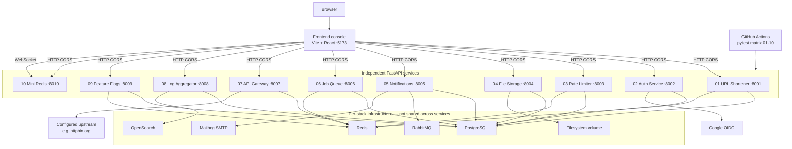

The frontend talks **directly** to each backend. The API gateway is a standalone reverse-proxy lab — it does **not** front the other nine services.

| # | Directory | Port | Persistence | Cache / queue | Extra |
|---|-----------|------|-------------|---------------|-------|
| 01 | `01-url-shortener` | 8001 | PostgreSQL `short_urls` | Redis read-through | optional Java twin |
| 02 | `02-auth-service` | 8002 | PostgreSQL `users`, `refresh_tokens` | — | Google OIDC |
| 03 | `03-rate-limiter` | 8003 | PostgreSQL `policies` | Redis Lua scripts | in-memory fallback |
| 04 | `04-file-storage` | 8004 | PostgreSQL `buckets`, `objects` | — | disk volume |
| 05 | `05-notification-service` | 8005 | PostgreSQL `notifications` | RabbitMQ + worker | Mailhog |
| 06 | `06-job-queue` | 8006 | PostgreSQL `jobs`, `schedules` | Redis list + worker | `echo` / `http_ping` |
| 07 | `07-api-gateway` | 8007 | — | Redis sliding window | JWT + proxy |
| 08 | `08-log-aggregator` | 8008 | PostgreSQL `sources` | OpenSearch index | source tokens |
| 09 | `09-feature-flags` | 8009 | PostgreSQL `flags` | Redis flag cache | sticky % buckets |
| 10 | `10-mini-redis` | 8010 | in-process dict | — | WebSocket pub/sub |

---

## Frontend console

Vite + React app in [`frontend/`](../frontend/). Routes under `/services/{slug}` each call one backend via `VITE_*_URL` (defaults `http://localhost:8001`–`8010`). Health badges poll `/health`. Mini Redis also opens a WebSocket at `/v1/subscribe`.

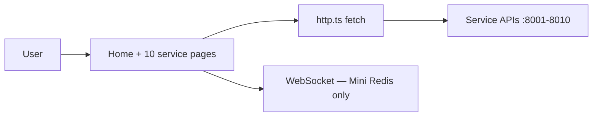

---

## 01 — URL Shortener

**Role:** Create short codes (or custom aliases), 302-redirect visitors, cache destinations in Redis, track click counts.

**Stack:** FastAPI, PostgreSQL, Redis (`CACHE_TTL_SECONDS`, default 24h). Compose: `app` + `postgres` + `redis`.

### Create short URL

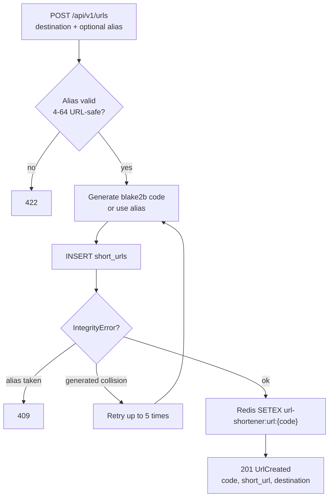

### Redirect + stats

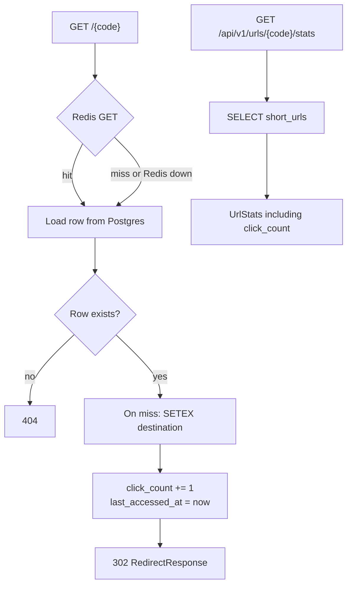

Redirect always writes analytics to Postgres even on a cache hit. Redis is a destination cache, not a click store.

---

## 02 — Auth Service

**Role:** Email/password auth, short-lived JWT access tokens, rotating refresh tokens, RBAC, optional Google OIDC.

**Stack:** FastAPI, PostgreSQL, `pwdlib` (Argon2), PyJWT HS256. Compose: `app` + `postgres`.

### Register / login / refresh / logout

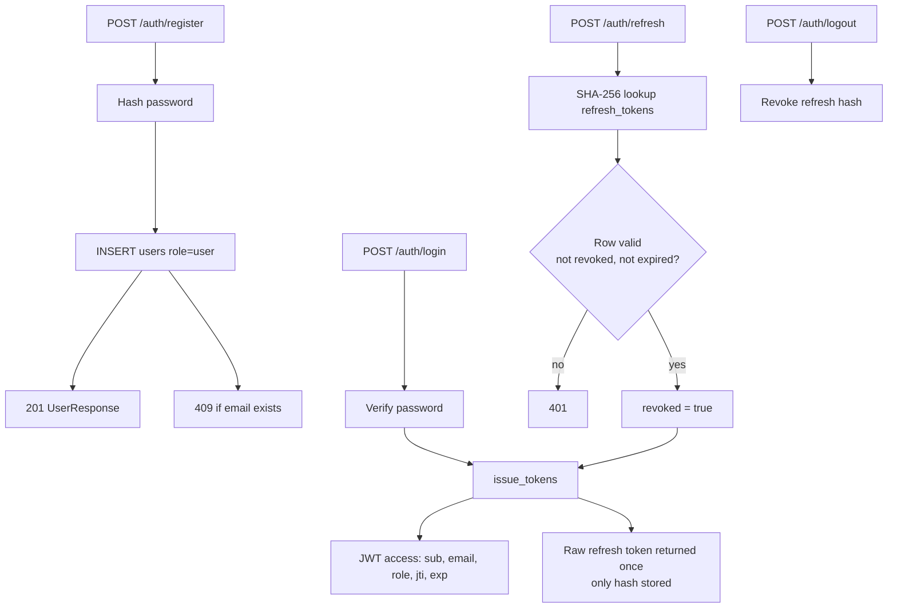

### Protected routes + Google OIDC

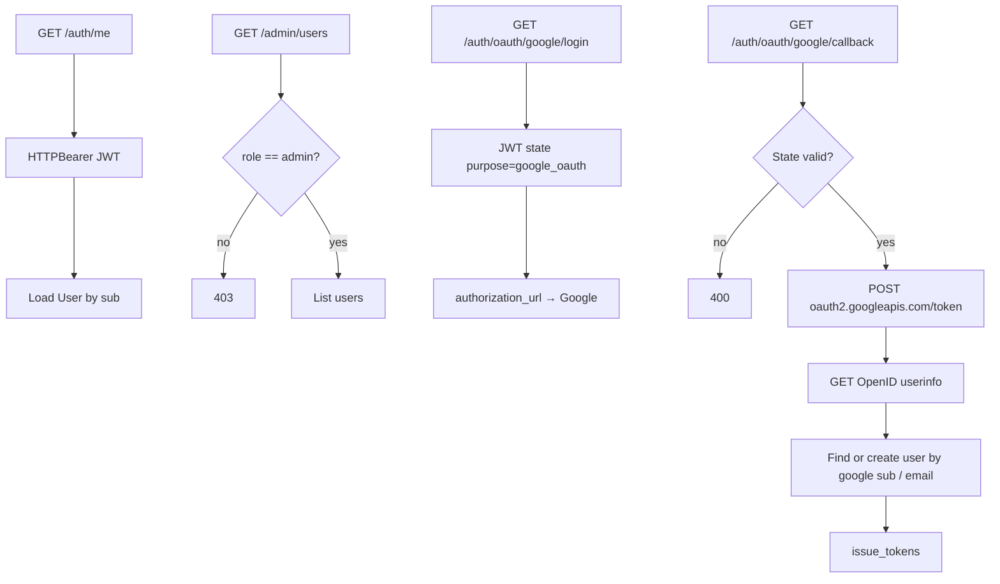

---

## 03 — Rate Limiter

**Role:** Durable per-client policies; atomic quota checks via Redis Lua (token bucket or sliding window). Falls back to an in-memory deque if Redis is down.

**Stack:** FastAPI, PostgreSQL, Redis. Compose: `app` + `postgres` + `redis`.

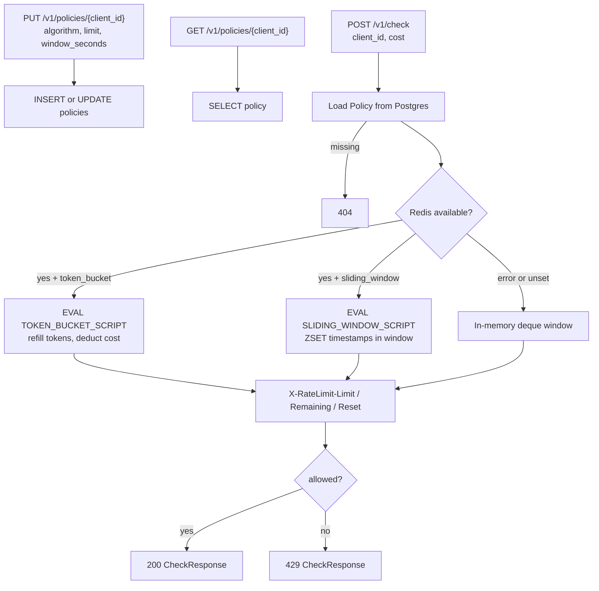

Token bucket refills continuously (`limit / window_seconds`). Sliding window counts events in the last `window_seconds` via a Redis sorted set.

---

## 04 — File Storage

**Role:** Mini S3: buckets, object upload/download/delete, HMAC-SHA256 signed URLs. Bytes on disk; metadata in Postgres. Path traversal is rejected.

**Stack:** FastAPI, PostgreSQL, filesystem volume. Compose: `app` + `postgres` + volume `objects`.

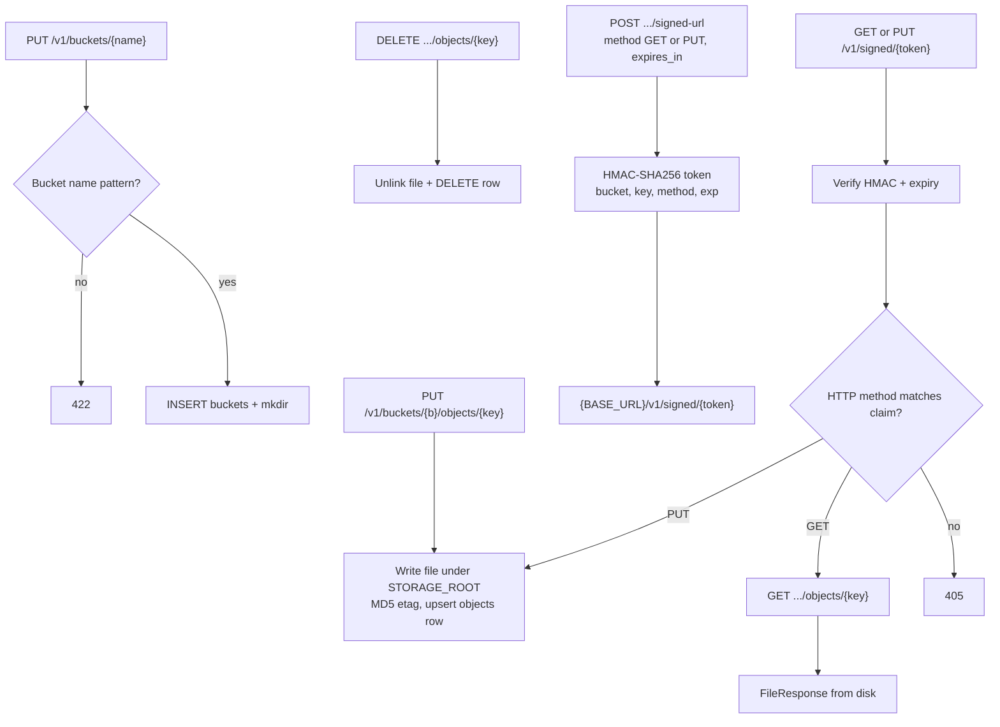

---

## 05 — Notification Service

**Role:** Queue email and webhook deliveries. RabbitMQ worker with retries and a dead-letter queue. Local Compose includes Mailhog (`:8025` UI, SMTP `:1025`).

**Stack:** FastAPI, PostgreSQL, RabbitMQ, SMTP. Compose: `app` + `worker` + `postgres` + `rabbitmq` + `mailhog`.

Without `RABBITMQ_URL`, enqueue processes inline (in-process retry).

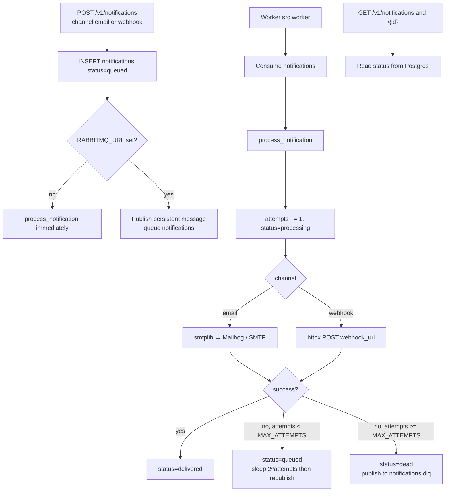

API returns **202** on create. Delivery is asynchronous when RabbitMQ is enabled.

---

## 06 — Job Queue

**Role:** Enqueue background tasks (`echo`, `http_ping`), Redis list worker, interval schedules that materialize into jobs.

**Stack:** FastAPI, PostgreSQL, Redis. Compose: `app` + `worker` + `postgres` + `redis`.

Without Redis, jobs execute inline in the API process.

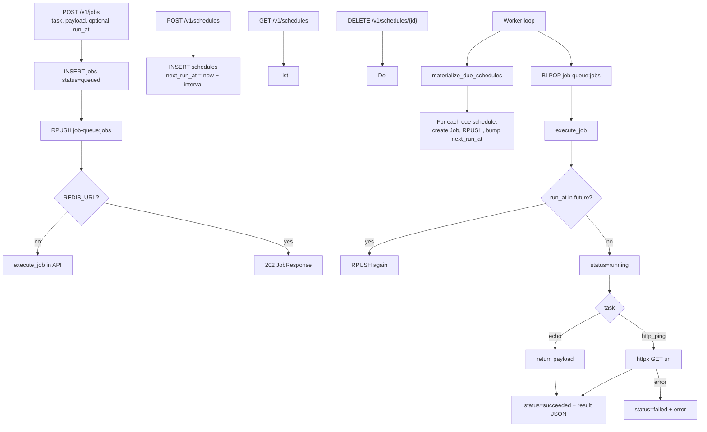

---

## 07 — API Gateway

**Role:** Self-contained reverse proxy. Embedded JWT validation and local rate limits. **Does not call** the auth or rate-limiter services.

**Stack:** FastAPI, Redis (optional; in-memory fallback), httpx. Compose: `app` + `redis`. Routes from `GATEWAY_ROUTES` JSON (default `/upstream` → `https://httpbin.org`, private).

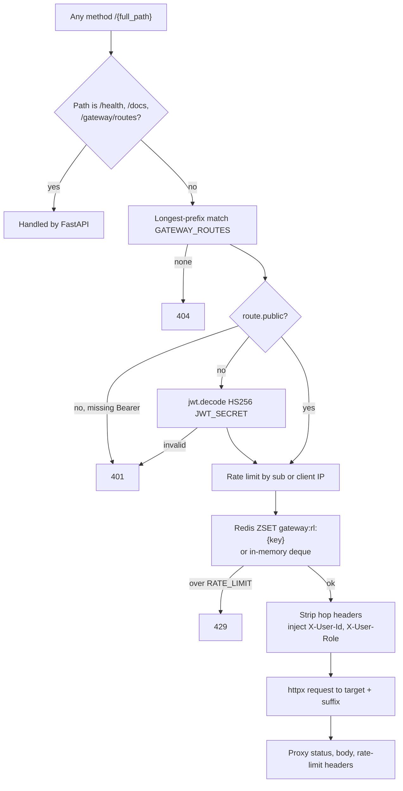

`GET /gateway/routes` lists configured prefixes without proxying.

---

## 08 — Log Aggregator

**Role:** Register ingest sources (token shown once, stored hashed). Index structured logs in OpenSearch; search by text, service, level, time. Falls back to in-memory docs if OpenSearch is down.

**Stack:** FastAPI, PostgreSQL, OpenSearch. Compose: `app` + `postgres` + `opensearch` (`:9200`).

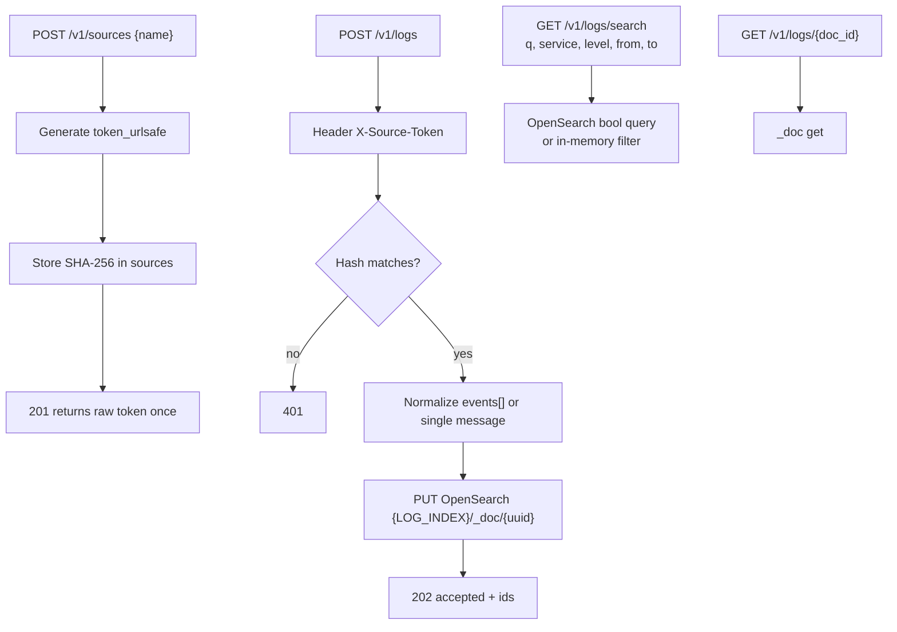

Search is open (no source token). Ingest is token-gated.

---

## 09 — Feature Flags

**Role:** Upsert flags with percentage rollouts and AND-combined attribute rules. Definitions cached in Redis for evaluate.

**Stack:** FastAPI, PostgreSQL, Redis (`CACHE_TTL_SECONDS`, default 60s). Compose: `app` + `postgres` + `redis`.

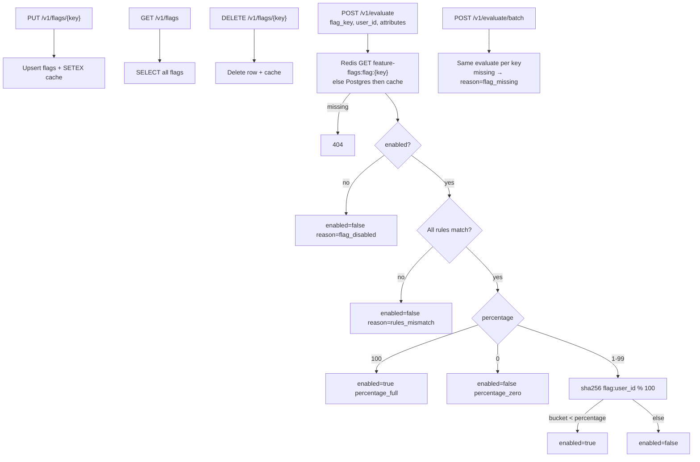

Rule ops: `eq`, `neq`, `in`, `contains`. Percentage bucketing is sticky per `(flag_key, user_id)`.

---

## 10 — Mini Redis

**Role:** In-process key/value with optional TTL and WebSocket pub/sub. Data is lost on process restart. No Postgres/Redis sidecar.

**Stack:** FastAPI only. Compose: `app` on `:8010`. A background task purges expired keys every second.

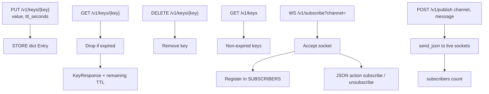

---

## Java URL Shortener (optional twin)

[`java/url-shortener`](../java/url-shortener/) is a Spring Boot port of service 01: same REST contract, PostgreSQL + Redis, OpenAPI at `/docs`, port `8001`. Workflow matches [01 — URL Shortener](#01--url-shortener). Run either the Python or Java compose stack, not both.

---

## CI

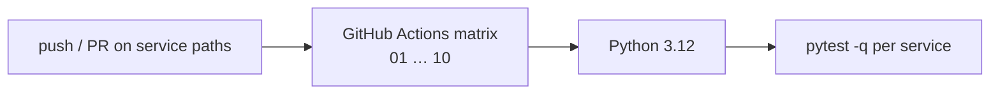

Workflow: [`.github/workflows/test-services.yml`](../.github/workflows/test-services.yml).

---

## Design notes

- **No service mesh.** The console and each Compose stack are the only “integration.” Gateway JWT/rate-limit logic is duplicated on purpose so the gateway stays self-contained.
- **Degraded modes.** Rate limiter, gateway, feature-flag cache, job queue, notifications, and log aggregator keep working without Redis / RabbitMQ / OpenSearch via in-memory or inline paths.
- **Workers.** Only notifications and the job queue run a second process (`python -m src.worker`).
- **Auth boundary.** Auth issues JWTs; the gateway verifies JWTs with its own `JWT_SECRET`. They are compatible only if those secrets match.
